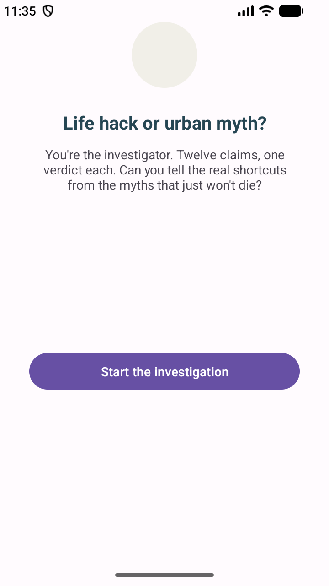

# Life Hack or Urban Myth?

## Purpose
is a flashcard quiz app for android. it shows 12 claims, and the user decideswhether each anwer is real life hack or a myth.
after each answer it explains why, so the user learns the facts instead of guessing.
 
## Design considerations
Colors: Hack is blue and Myth is red so that makes it easy to tell the two options apart. The score circle is gold so it feels like a reward, and navy text keeps everything readable on the light background.
Layout: One claim per screen, with large tap-friendly buttons. At the top the case number (“Case 5/12”) and the live score so the user always knows how they are progressing.
Feedback: The explanation follows each answer immediately. The Hack and Myth buttons are then locked so that a question can not be answered twice, then only unlocks once an answer has been entered.

Score screen: The message changes depending on the result ("Master hacker!", "Getting there!", "Stay Safe Online!") to give personalized feedback.
Review: A scrollable list of all 12 claims, with the correct answer and explanation, so that users can learn from their mistakes.

## How it works
The quiz begins with the Welcome screen. QuestionActivity loops through a list of 12 questions using an index, increments a score counter for each correct answer, and logs each step using Log. d. It passes the score to ScoreActivity with an Intent after question 12. The Score screen uses a when-statement to pick a message. The Review button opens ReviewActivity which constructs the list from the same question data.

## GitHub and GitHub Actions
I committed my work to git after every feature was finished (question logic, score and review screens) and this kept a clean history. I added a GitHub Actions workflow (build.yml) which runs on every push to master. It installs Java 17, builds the debug APK via Gradle and uploads it as an artifact. This catches build errors earlier. The build passes as per the green tick below.

## Screenshots

 
## Video demo
[Watch the demo video](https://youtube.com/shorts/y33v0DT7PUI?si=ye5De64-e8gCI4ng)

## References
Android Developers (n.d.) Intents and intent filters. Available at: https://developer.android.com/guide/components/intents-filters (Accessed: 3 October 2026).

Android Developers (n.d.) Log. Available at: https://developer.android.com/reference/android/util/Log (Accessed: 3 October 2026).

Android Developers (n.d.) String resources. Available at: https://developer.android.com/guide/topics/resources/string-resource (Accessed: 3 October 2026).

Kotlin (n.d.) Conditions and loops (when expression). Available at: https://kotlinlang.org/docs/control-flow.html (Accessed: 3 October 2026).

Kotlin (n.d.) Data classes. Available at: https://kotlinlang.org/docs/data-classes.html (Accessed: 3 October 2026).

GitHub (n.d.) GitHub Actions documentation. Available at: https://docs.github.com/en/actions (Accessed: 3 October 2026).